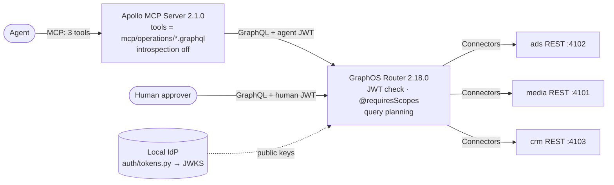

# Architecture

## The pieces

Paths A and A′ (`baseline/`) are Python MCP servers that call the same three REST services directly.

## One request, step by step (Path B, `CampaignPerformance`)

1. The agent calls the MCP tool `CampaignPerformance` with `campaignId`.
2. The Apollo MCP Server runs the matching operation file, `mcp/operations/CampaignPerformance.graphql`. It adds `Authorization: Bearer <agent JWT>` from its config and sends the query to the router.
3. The router checks the JWT signature against the JWKS and reads the token's `scope` claim: `campaign:read proposal:write`.
4. `Query.campaign` needs `campaign:read`, which the agent has. The router plans the query across two connector subgraphs, `ads` and `media`.
5. The Connectors call REST: `GET /campaigns/cmp-acme-q4`, `GET /campaigns/cmp-acme-q4/line-items`, then `GET /segments/{id}` once per line item.
6. The router maps each REST response to the selected GraphQL fields and drops the rest. The line item's targeting, pacing and bid settings never leave the router.
7. The MCP server returns the JSON to the agent. Across the whole task (three calls) the agent receives 860 characters, against 11,380 across ten calls on Path A.

The write path splits by risk. `ProposeBudgetMove` needs `proposal:write`, which the agent has, and records a proposal that moves no money. `applyBudgetMove` needs `budget:write`, which only the human's token has, and it is not an MCP tool at all. Measured: a direct `applyBudgetMove` with the agent's token returns `data: null` with `UNAUTHORIZED_FIELD_OR_TYPE`, and the request never reaches the ads service.

## Design decisions

| Decision | Chosen | Why | Alternative |
|---|---|---|---|
| Where the agent's tools come from | Operation files, introspection and execute off | The agent can run exactly three operations, and each one is reviewed like code | Introspection plus `execute`: flexible, but the agent writes its own queries |
| Where field rules live | `@requiresScopes` in the schema | One rule for every client of the graph, enforced by the router | Filtering in each tool's code (Path A′): works, but per server and per author |
| How REST becomes GraphQL | Connectors | No resolver service to write or run | A Python or Node subgraph per API |
| Writes | Propose (agent) and apply (human) as separate operations | A tool that can be undone and one that moves money should not share a tool, so the agent can be given the safe one alone | One `updateBudget` with a mode flag |
| Agent identity | One static agent JWT in the MCP server config | Enough to show scopes at the router | Per-user tokens passed through the MCP server, so the agent acts as a named person (the "Identity" idea in Apollo's Agent Services preview) |

## What this repo does not show (the production path)

- **Router deployment:** a self-hosted GraphOS Router in containers (for example Kubernetes), connected to GraphOS for its license. Here it runs under `rover dev` on a laptop. The Free plan caps the router at 60 requests a minute.
- **Identity:** JWKS from the company's identity provider, not `auth/tokens.py`. Scopes or claims mapped from groups.
- **A safelist at the router:** here, only the MCP server is limited to three operations. The agent's token can still send any query straight to the router, and the router then applies the field rules. A persisted query list (operations registered in advance, everything else rejected; it needs a GraphOS plan that includes persisted query lists) closes that gap. It is not used here. The router also answers introspection here, so any caller with a valid token can read the schema; turn that off outside development.
- **Change safety:** `scripts/check_operations.py` validates the agent's operations against the composed graph. In production, GraphOS schema checks compare a proposed schema against real recorded operations before it ships.
- **Observability:** router telemetry over OpenTelemetry (traces and metrics, tagged by client) to the team's existing tools, plus GraphOS metrics per operation. Not built here.
- **Stopping an agent:** removing an operation file removes the tool while the server runs (tested: the tool list went from 3 to 2 within about 2 s and back within about 3 s, with no restart). Revoking the agent's token or scope at the identity provider stops it everywhere.

## Where GraphQL is the wrong tool

Bulk exports and file transfer, binary or streaming payloads, and a single small CRUD service with one client. In those cases plain REST, or a purpose-built tool like Path A′, is simpler.
